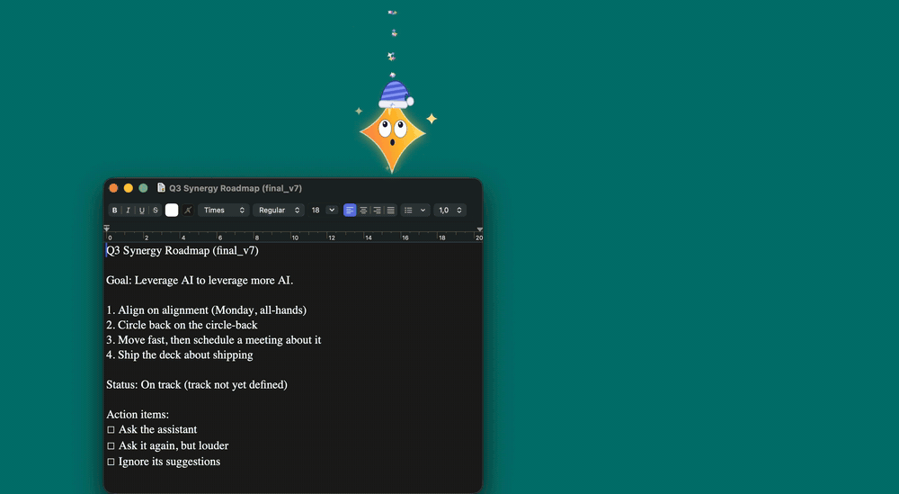

# Unprompted ✨

Clippy for the AI age: a small, overly helpful assistant that lives on your Mac's desktop.
It wanders around, walks on top of your windows, sits on the Dock, and offers "help" nobody asked for.

It's a parody of AI assistants, with a few genuinely useful tricks. It runs entirely on your Mac: no AI model, no network, no account.
It's also light on your battery: about 1–3% of one CPU core while it sits around and 4–11% while it walks (measured on an M3 Pro), and its animation stops while your screen is off or locked.




## Features

### It lives on your desktop

- **Above everything**: it floats over windows, the menu bar and the Dock, on every Space and over full-screen apps. Clicks on transparent areas go through to whatever is underneath.
- **Physics**: it walks, jumps and falls, lands on the tops of other windows and rides along when you move them. Close the window and it falls.
- **Climbing and exploring**: it climbs the sides of windows, dangles from window edges, peeks in from the screen edge, sneaks behind your windows to peek out from behind them, and walks between screens, climbing up to higher ones and walking off one side to come back in on the other.
- **Wandering**: too restless for you? Set **Wandering** to **Now and then**, or to **Stays put**: then it walks off to a corner of the screen, out of your way, and stays there, still breathing, blinking and looking around. Playing with it and **Come Here** still work.
- **Drag and throw**: pick it up and fling it. It has opinions about this. Throw it and it runs back for another go (fetch). Sometimes it chases your cursor.
- **The Trash**: lift it up while you carry it and a trash can appears in the corner. Drop it in and it's deleted, dramatically, then comes back from "the cloud". Carried along low, you can put it down in that corner without throwing it away. **Use Real Dock Trash** aims for the Dock's Trash instead.
- **Petting and mood**: wiggle the cursor over it and it purrs and shows hearts. Its mood rises when you're nice to it and falls when you're not; happy assistants play more, sad ones mope.
- **Interns**: ignore it long enough and it hires a smaller helper. Paying attention sends the interns home; clicking one pops it.
- **Costumes and time of day**: a pumpkin in October, a Santa hat in December, a party hat on New Year's Day, a nightcap late at night and a coffee mug in the morning.

### It "helps"

- **Ask Me Anything**: a chat box next to the creature. It's an ELIZA-style pattern matcher with real skills: math, unit conversion, definitions from the macOS dictionary, the time (also in other cities), reminders and timers, opening apps and websites, web search, coins, dice and jokes. Anything else gets a confidently wrong answer. Type `help` for the list.
- **Rewrite Clipboard**: copy text anywhere, pick a style, paste the result. More Engaging, LinkedIn, Corporate, Pirate and Mocking, plus useful ones: UPPERCASE, lowercase, Title Case and Clean Up Spacing. Undo restores the original.
- **"AI" file summaries**: drop a file on it for a summary that's really just honest stats with a punchline. Text, code, PDFs, Word and RTF documents, images, video and audio, folders, apps, or several files at once.
- **Daily report**: a fake-AI report built from real numbers: active time, keystroke count (never which keys), time per app, app switches and how you treated it. It offers to show it in the evening.
- **Sticky notes**: now and then it leaves a note on your screen. Click to crumple it.
- **Context-aware heckling**: it reacts to the app you switch to, the time of day, long typing sessions and low battery. Its answers stream in word by word, sometimes after a fake "Reasoning…" pause, and some questions come with Clippy's **[Yes] [No] [Don't show again]** buttons. "Don't show again" is saved, confirmed with a ✅, and then cheerfully ignored, just like the original.

### It (mostly) knows when to stop

- **Quiet mode**: during calls (Zoom, Teams, FaceTime, Webex, and anything else using your microphone, like a call in a chat app or the browser) and when an app is full screen (presentations, videos), it hides or just stays silent. Optional quiet hours.
- **Annoyance Level**: Polite, Eager, Clingy or Unhinged.
- **Snooze for 1 Hour**, sulking when you dismiss it twice in a row, and sleeping while you're away.
- **Settings window** (✨ menu → **Settings…**): character, movement, wandering, costume, size, speed, chattiness, feature toggles, quiet mode and launch at login.

## Getting started

Unprompted needs macOS 13 Ventura or later, on an Apple silicon or Intel Mac. It's developed and tested on macOS 26 on Apple silicon; older macOS versions and Intel Macs should work but haven't been tested yet, so reports are welcome. Once it runs, look for the ✨ in the menu bar; there's no Dock icon. Turn on **Launch at Login** in the ✨ menu to keep it around.

### Download

1. Download the zip from the [latest release](https://github.com/AdrianJHerskind/Unprompted/releases/latest) and unzip it.
2. Move **Unprompted** to your Applications folder, then open it.

The app isn't notarized by Apple (that takes a yearly developer fee), so macOS blocks it the first time you open it:

1. Close the warning that macOS can't check the app.
2. Open **System Settings → Privacy & Security**, scroll down and click **Open Anyway** next to Unprompted.
3. Confirm with **Open**. From then on, it opens normally.

### Build it yourself

You need the Swift 5.9 toolchain or newer (Xcode 15 or later, or the Command Line Tools: `xcode-select --install`).

Clone the repository and build it:

```bash
git clone https://github.com/AdrianJHerskind/Unprompted.git
cd Unprompted
./build.sh
```

This builds the app, installs it in `/Applications` and starts it.

- `./build.sh --no-install` only builds `build/Unprompted.app`.
- `./build.sh debug` makes a debug build.
- `./build.sh --universal` builds for both Apple silicon and Intel.
- `swift run` also works from the project folder while developing.

### Uninstall

1. If you turned on **Launch at Login**, turn it off in the ✨ menu.
2. Choose **Quit** in the ✨ menu, then move **Unprompted** from Applications to the Trash.
3. To remove its settings and daily statistics as well, run `defaults delete io.github.adrianjherskind.unprompted` in Terminal. If you added your own characters, also delete `~/Library/Application Support/Unprompted`.
4. If you used **Use Real Dock Trash**, remove Unprompted from **System Settings → Privacy & Security → Accessibility**.

## Privacy

It's meant to be annoying, not creepy:

- **It needs no permissions.** It asks macOS for the list of windows and uses only their positions and which app they belong to, which needs no permission. Titles and contents would need Screen Recording access, which it never asks for.
- **It counts key presses for the daily report, but never sees which keys.** It reads macOS's system-wide key-press counter, a single number. It doesn't install a keyboard monitor.
- **To notice calls in any app, it asks macOS whether some app is using the microphone.** Core Audio answers with yes or no per app. It never opens the microphone itself or hears anything.
- **It reads the clipboard only when you pick a rewrite, and files only when you hand them over.**
- **Nothing leaves your Mac.** There's no networking code in the app at all; links and searches you ask for open in your browser.
- **Its settings and seven days of daily statistics are stored locally** in its preferences (see [Uninstall](#uninstall)).
- The optional **Use Real Dock Trash** needs Accessibility permission, only to find the Trash icon in the Dock.

## Characters

Looks are separate from behavior. Switch them in the ✨ menu (**Character**) or by clicking the creature (**Change My Look**).

| Character | |
|---|---|
| **Sparkle** | A googly-eyed ✨ that follows your cursor with its eyes. Drawn in code |
| **Cookie Banner** | A "We use cookies" banner on little legs, with Reject/Accept buttons that react to its mood. Drawn in code |
| **Ghost** | A slightly see-through ghost with a waving hem that floats instead of walking. Drawn in code |
| **Loading Spinner** | A googly-eyed loading spinner that rolls everywhere and spins faster while it "thinks". Drawn in code |
| **Rubber Duck** | Pixel art. In the chat it does real rubber-duck debugging and answers with questions that help you explain your bug |
| **Mr. Byte** | Frame-by-frame pixel art of a retro beige computer with legs |

Each has its own gait: **walk** (Mr. Byte, Cookie Banner), **waddle** (Rubber Duck), **hop** (Sparkle), **float** (Ghost) or **roll** (Loading Spinner). Override it for any character under **Movement**.

### Make your own

Choose **Open Characters Folder…** in the ✨ menu (`~/Library/Application Support/Unprompted/Characters`).
Create a folder with PNG frames (transparent background) and a `character.json`:

```json
{
  "name": "My Character",
  "frameWidth": 32, "frameHeight": 32, "scale": 3,
  "footInset": 1,
  "walkSpeed": 60, "bounciness": 0.3,
  "facesRight": true,
  "movement": "walk",
  "hat":  { "x": 16, "y": 6, "width": 12 },
  "hand": { "x": 28, "y": 22, "height": 8 },
  "animations": {
    "idle": { "frames": ["idle_0.png", "idle_1.png"], "fps": 2 },
    "walk": { "frames": ["walk_0.png", "walk_1.png"], "fps": 8 }
  },
  "quips": ["Something only this character would say."]
}
```

Only `idle` is required. The other states are `walk`, `fall`, `drag`, `talk`, `sulk`, `sleep` and `happy`; missing ones reuse `idle`.
`hat` and `hand` (optional, in source pixels from the top-left) say where hats sit and where held props like the morning coffee go.
`movement` is `walk`, `waddle`, `hop`, `roll` or `float`, and `bounciness` goes from 0 (a sack of potatoes) to 0.9.
Then choose **Reload Characters**. `Resources/Characters/mrbyte/` is a complete example. To draw a character in code instead, see [CONTRIBUTING.md](CONTRIBUTING.md#characters-drawn-in-code).

## Contributing

Contributions are welcome: new characters, quips, chat skills, rewrite styles, file types to summarize, bug fixes and performance work. [CONTRIBUTING.md](CONTRIBUTING.md) explains how to work on it, the guidelines, how to check CPU use, how to report bugs and where everything is in the code.

## Supporting Unprompted

If Unprompted made you smile, you can [sponsor it on GitHub](https://github.com/sponsors/AdrianJHerskind), monthly or once. It's completely optional, and unlike "Don't show again", that one is meant seriously.

## License

Unprompted is released under the [MIT License](LICENSE). By opening a pull request, you agree that your contribution is licensed under it too.

## Disclaimer

Unprompted is a parody. It isn't affiliated with Microsoft, Apple or any company whose products it jokes about. Clippy is a trademark of Microsoft.
