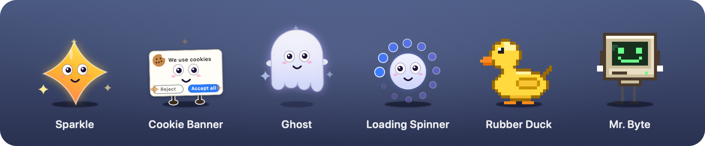

# Unprompted ✨

Clippy for the AI age: a small, overly helpful assistant that lives on your Mac's desktop.
It wanders around, walks on top of your windows, sits on the Dock, and offers "help" nobody asked for.

It's a parody of AI assistants, with a few genuinely useful tricks. It runs entirely on your Mac: no AI model, no network, no account.



## Features

### It lives on your desktop

- **Above everything**: it floats over windows, the menu bar and the Dock, on every Space and over full-screen apps. Clicks on transparent areas go through to whatever is underneath.
- **Physics**: it walks, jumps and falls, lands on the tops of other windows and rides along when you move them. Close the window and it falls.
- **Climbing and exploring**: it climbs the sides of windows, dangles from window edges, peeks in from the screen edge, and walks between screens, climbing up to higher ones and walking off one side to come back in on the other.
- **Wandering**: too restless for you? Set **Wandering** to **Now and then**, or to **Stays put**: then it walks off to a corner of the screen, out of your way, and stays there, still breathing, blinking and looking around. Playing with it and **Come Here** still work.
- **Drag and throw**: pick it up and fling it. It has opinions about this. Throw it and it runs back for another go (fetch). Sometimes it chases your cursor.
- **The Trash**: lift it up while you carry it and a trash can appears in the corner. Drop it in and it's deleted, dramatically, then comes back from "the cloud". Carried along low, you can put it down in that corner without throwing it away. **Use Real Dock Trash** aims for the Dock's Trash instead.
- **Petting and mood**: wiggle the cursor over it and it purrs and shows hearts. Its mood rises when you're nice to it and falls when you're not; happy assistants play more, sad ones mope.
- **Interns**: ignore it long enough and it hires a smaller helper. Paying attention sends the interns home; clicking one pops it.
- **Costumes and time of day**: a pumpkin in October, a Santa hat in December, a party hat on New Year's Day, a nightcap late at night and a coffee mug in the morning.

### It "helps"

- **Ask Me Anything**: a chat box next to the creature. It's an ELIZA-style pattern matcher with real skills: math, unit conversion, definitions from the macOS dictionary, the time (also in other cities), reminders and timers, opening apps and websites, web search, coins, dice and jokes. Anything else gets a confidently wrong answer. Type `help` for the list.
- **Rewrite Clipboard**: copy text anywhere, pick a style, paste the result. More Engaging, LinkedIn, Corporate, Pirate and Mocking, plus useful ones: UPPERCASE, lowercase, Title Case and Clean Up Spacing. Undo restores the original.
- **"AI" file summaries**: drop a file on it for a summary that's really just honest stats with a punchline. Text, code, PDFs, Word and RTF documents, images, video and audio, folders, apps, or several files at once.
- **Daily report**: a fake-AI report built from real numbers: active time, keystroke count (never which keys), time per app, app switches and how you treated it. It offers to show it in the evening.
- **Sticky notes**: now and then it leaves a note on your screen. Click to crumple it.
- **Context-aware heckling**: it reacts to the app you switch to, the time of day, long typing sessions and low battery. Its answers stream in word by word, sometimes after a fake "Reasoning…" pause, and some questions come with Clippy's **[Yes] [No] [Don't show again]** buttons. "Don't show again" works. Eventually.

### It (mostly) knows when to stop

- **Quiet mode**: during calls (Zoom, Teams, FaceTime, Webex) and when an app is full screen (presentations, videos), it hides or just stays silent. Optional quiet hours.
- **Annoyance Level**: Polite, Eager, Clingy or Unhinged.
- **Snooze for 1 Hour**, sulking when you dismiss it twice in a row, and sleeping while you're away.
- **Settings window** (✨ menu → **Settings…**): character, movement, wandering, costume, size, speed, chattiness, feature toggles, quiet mode and launch at login.

## Getting started

You need macOS 13 Ventura or later and the Swift 5.9 toolchain or newer (Xcode 15 or later, or the Command Line Tools: `xcode-select --install`).

Clone the repository, then in its folder:

```bash
./build.sh
```

This builds the app, installs it in `/Applications` and starts it. Look for the ✨ in the menu bar; there's no Dock icon. Turn on **Launch at Login** in the ✨ menu to keep it around.

- `./build.sh --no-install` only builds `build/Unprompted.app`.
- `./build.sh debug` makes a debug build.
- `swift run` also works from the project folder while developing.

## Privacy

It's meant to be annoying, not creepy:

- It needs no permissions. Window *positions* are readable without Screen Recording access; it never reads window contents or titles.
- It counts key presses for the daily report, but never sees which keys.
- It reads the clipboard only when you pick a rewrite, and files only when you hand them over.
- Nothing leaves your Mac. It makes no network requests; links and searches you ask for open in your browser.
- Its settings and seven days of daily statistics are stored locally in its preferences.
- The optional **Use Real Dock Trash** needs Accessibility permission, only to find the Trash icon in the Dock.

## Characters

Looks are separate from behavior. Switch them in the ✨ menu (**Character**) or by clicking the creature (**Change My Look**).

| Character | |
|---|---|
| **Sparkle** | A googly-eyed ✨ that follows your cursor with its eyes. Drawn in code |
| **Cookie Banner** | A "We use cookies" banner on little legs, with Reject/Accept buttons that react to its mood. Drawn in code |
| **Ghost** | A slightly see-through ghost with a waving hem that floats instead of walking. Drawn in code |
| **Loading Spinner** | A googly-eyed loading spinner that rolls everywhere and spins faster while it "thinks". Drawn in code |
| **Rubber Duck** | Pixel art. In the chat it does real rubber-duck debugging and answers with questions that help you explain your bug |
| **Mr. Byte** | Frame-by-frame pixel art of a retro beige computer with legs |

Each has its own gait: **walk** (Mr. Byte, Cookie Banner), **waddle** (Rubber Duck), **hop** (Sparkle), **float** (Ghost) or **roll** (Loading Spinner). Override it for any character under **Movement**.

### Make your own

Choose **Open Characters Folder…** in the ✨ menu (`~/Library/Application Support/Unprompted/Characters`).
Create a folder with PNG frames (transparent background) and a `character.json`:

```json
{
  "name": "My Character",
  "frameWidth": 32, "frameHeight": 32, "scale": 3,
  "footInset": 1,
  "walkSpeed": 60, "bounciness": 0.3,
  "facesRight": true,
  "movement": "walk",
  "hat":  { "x": 16, "y": 6, "width": 12 },
  "hand": { "x": 28, "y": 22, "height": 8 },
  "animations": {
    "idle": { "frames": ["idle_0.png", "idle_1.png"], "fps": 2 },
    "walk": { "frames": ["walk_0.png", "walk_1.png"], "fps": 8 }
  },
  "quips": ["Something only this character would say."]
}
```

Only `idle` is required. The other states are `walk`, `fall`, `drag`, `talk`, `sulk`, `sleep` and `happy`; missing ones reuse `idle`.
`hat` and `hand` (optional, in source pixels from the top-left) say where hats sit and where held props like the morning coffee go.
`movement` is `walk`, `waddle`, `hop`, `roll` or `float`, and `bounciness` goes from 0 (a sack of potatoes) to 0.9.
Then choose **Reload Characters**. `Resources/Characters/mrbyte/` is a complete example.

For a look made in code, implement `CharacterPack` and a `CharacterView` subclass and add it to `CharacterLibrary.loadAll()`. The view builds the character from Core Animation layers in its `contentLayer` and brings them up to date in `updateContent()`, including `spin`, the hat and the prop (`turn` is taken care of). Subclass `GooglyCharacterView` instead to get the googly face, poses and extras of the built-in characters: it only needs a body, built from layers in `makeLayeredBody` or, more simply but at a higher cost, drawn in `drawBody` for every update.

To keep a code-drawn character only on your Mac, put it in `Sources/Unprompted/Characters/Local/`, which git ignores, and hand it over through a `LocalCharacters` class there (see `LocalCharacterSource` in `CharacterLibrary.swift`).

## Contributing

Contributions are welcome: new characters, quips, chat skills, rewrite styles, file types to summarize, bug fixes and performance work. For bigger changes, please open an issue first so we can agree on the idea before you put in the work.

### Working on it

- `swift build` is the quickest check that everything compiles. `./build.sh` installs and restarts the app so you can try your change.
- The ✨ menu shows a **Status** line (napping, sulking, climbing…). For more detail, run `UNPROMPTED_DEBUG=1 build/Unprompted.app/Contents/MacOS/Unprompted`, which prints the creature's internal state every second.
- Builds are signed ad hoc, so macOS forgets the Accessibility permission (only used by **Use Real Dock Trash**) after each rebuild. Remove the app from System Settings → Privacy & Security → Accessibility and allow it again.
- The app icon and the pixel-art characters are generated by the scripts in `tools/`, for example `swift tools/generate-icon.swift Resources`.

### Guidelines

- **Keep the privacy promise** above: no network requests, nothing read in the background, and no new permissions without discussing it in an issue first.
- **Builds without warnings.** UI code runs on the main actor; the creature and its windows are only touched from there.
- **Put code where it belongs** (see the code map below) and follow the style of the code around it. Comments explain *why*, and only where that's not obvious.
- **Keep it light.** It runs all day next to your real work, so it has to stay cheap. Check what your change costs before you open a pull request (see [Checking CPU use](#checking-cpu-use)).
- **Only original art**, or art you have the rights to share. No trademarked logos or characters, please.
- **Friendly humor.** It teases AI hype, productivity culture and itself; it's never mean about people.

### Checking CPU use

Unprompted runs all day next to your real work, so it costs only a few percent of one core, and should stay that way. If your change touches characters, animation, the creature or its windows, compare it with where you started before you open a pull request:

```bash
tools/cpu-benchmark.sh --compare main
```

This builds your checkout (uncommitted changes included) and the commit on `main` your work started from. It runs a real creature for every character, standing, walking, talking (with a speech bubble) and asleep, alternating between the two builds, and prints what each costs. Quit Unprompted first and leave the Mac alone while it runs, about 10 minutes; it keeps the display awake. Don't lock or cover the screen either: a creature nobody can see stops drawing, so those runs fail. Paste the table into your pull request. Characters your change adds show up as `new`.

To look at one thing more closely, use something like `tools/cpu-benchmark.sh --compare main -c ghost -m walk -r 3`. Add `-a` to wear a hat and a coffee. The cursor stays in a corner of the screen while it runs, so eyes that follow it hold still; add `-M` to have it circle the creature instead (300 pt away, once every 4 seconds), as a cursor does in real use, and see what following it costs. `--help` lists all options. If your work is committed on `main` itself, compare with `origin/main` instead, or `upstream/main` in a fork.

The table has four columns:

- **App CPU**: the creature itself, in % of one core. On Apple silicon, macOS moves work between fast and efficient cores, so the same code can show twice the CPU from one run to the next.
- **App instr. M/s**: the instructions the creature ran, in millions a second. They don't depend on which cores did the work, so compare builds by these first.
- **WindowManager**: macOS's work for our windows. Activity Monitor doesn't count it as Unprompted's, but it's real: moving a window every frame costs about a third of a core here.
- **WindowServer**: the window server's extra work. It moves around a lot, so only trust big differences there.

WindowManager and WindowServer are shown above their idle level.

The benchmark runs one creature with the app's frame-loop rates and window-list rules. It doesn't run the rest of the app: the chat box, effects, interns, reminders and the other timers. For changes there, profile the real app (see the last tip below).

How to keep it light:

- **Use layers.** Build characters from Core Animation layers and change their properties (transform, position, opacity, a shape layer's path) instead of drawing. The window server moves, turns, fades and fills layers on the GPU. See `makeLayeredBody`, `SparkleBody`, `CookieBody`, `GhostBody` and `SpinnerBody`.
- **Repaint only what changed.** A `PaintedLayer` should repaint only when what it shows has changed (see how `GooglyCharacterView` keys the eyes and mouth). Parts that only move shouldn't be repainted at all: the pupils that follow the cursor are layers moving over a picture of the eyes. Parts that rarely change can be pictures (`showPicture`).
- **No blurs in drawing code.** `CGContext.setShadow` blurs on the CPU every time something is drawn, which was the biggest cost before. Use a layer shadow with a `shadowPath`, or `bodyGlow` for a drawn body.
- **Don't move windows every frame.** The creature moves inside a stage window that only follows now and then. Bubbles are only placed again when what they point at moves.
- **Calm poses can update less often** (`Creature.updateInterval(for:)`). Anything that moves updates every frame: motion has to stay smooth at 60 fps.
- **Don't ask macOS the same thing every frame.** Use `World`'s cached screens, visible frames and window list (`World.refreshIfNeeded(now:for:)` decides how fresh it needs to be).
- **Drawing text is expensive.** Draw it once into a picture where you can, as the Cookie Banner's card does.
- **Stop work nobody can see.** The frame loop stops while the screens are off or locked, and slows to 10 Hz while the creature dozes. New timers should do the same.
- **Profile to see where the time goes:** `/usr/bin/sample <pid> 10` (the `sample` on your PATH may be a Python package), or Instruments' Time Profiler.

### Pull requests

- One topic per pull request, please.
- Describe what you changed and how you tested it. There's no automated test suite yet, so say what you tried by hand (and on how many screens, if it's about movement).
- If it touches characters, animation, the creature or its windows, include the output of `tools/cpu-benchmark.sh --compare main`.
- For anything visible, a screenshot or short screen recording helps a lot.

### Reporting bugs

Open an issue with your macOS version, your display setup (how many screens, and which is the main one), what you did, what happened, and what you expected. For movement bugs, the `UNPROMPTED_DEBUG=1` output from around that moment is very helpful.

## Code map

Everything is in `Sources/Unprompted/`:

| Folder | What's in it |
|---|---|
| `App/` | Entry point, app delegate and the menu bar icon |
| `Assistant/` | The brain: when to talk and what to say. `Assistant.swift` has the update loops, presence (snoozing, quiet mode) and settings; the `Assistant+…` files have talking, reactions to events, actions, interns and the menus |
| `Creature/` | The body: its window (a stage the character moves around in) and frame update (`Creature.swift`), walking, falling and multiple screens (`+Movement`), climbing, hanging, peeking and the other activities (`+Activities`), petting, shaking and throwing (`Gestures.swift`), and `World.swift`: what it can stand on |
| `Characters/` | The looks: `CharacterPack` and `CharacterView`, the shared googly face (`GooglyCharacterView.swift`), the drawn characters, sprite characters, and hats and props (`Accessories.swift`) |
| `Models/` | Settings, mood, daily stats and report insights, annoyance levels, and everything it says (`Quips.swift`) |
| `Services/` | The chat brain and calculator, text rewrites, file summaries, reminders, the clipboard, quiet-mode detection, whether anyone can see the screens, the Dock's Trash and system info |
| `Views/` | The overlay windows, speech bubble, chat box, sticky notes, effects and trash can, and the SwiftUI Settings and Daily Report windows |
| `Support/` | Small helpers: colors, screen geometry, shapes, layers and word matching |

Sprite characters live in `Resources/Characters/`. `tools/` has the scripts that generate the icon and pixel art, and the CPU benchmark.

## License

Unprompted is released under the [MIT License](LICENSE). By opening a pull request, you agree that your contribution is licensed under it too.

## Disclaimer

Unprompted is a parody. It isn't affiliated with Microsoft, Apple or any company whose products it jokes about. Clippy is a trademark of Microsoft.
